# Macdows Commander

A native two-panel file manager for macOS, in the spirit of Windows Commander. Written in Swift and AppKit, keyboard first, with FTP, SSH, editors and an image tool built in.

**English** · [Türkçe](README.tr.md)

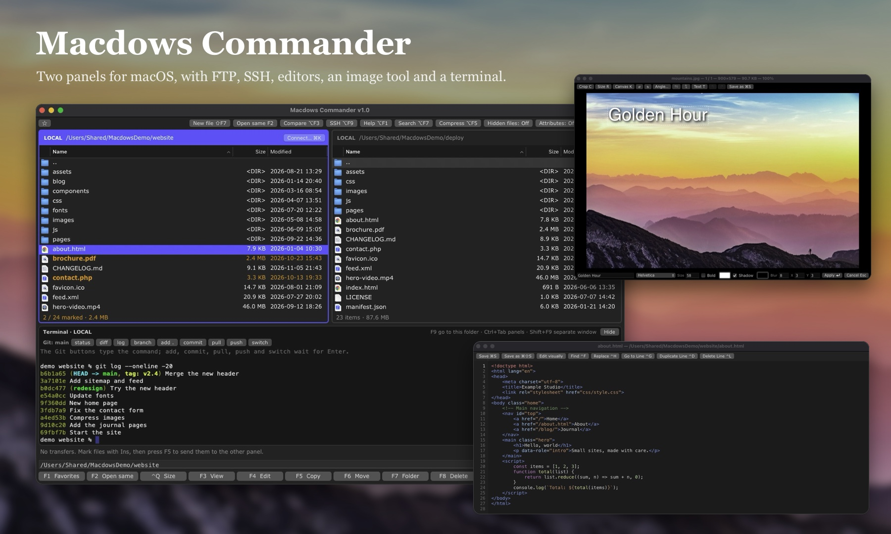

## Features

### Two panels, driven by the keyboard

- `Ins` or `Space` marks, `Shift`+click marks a range, `Ctrl+A` marks everything
- `F5` copies, `F6` moves, `F7` makes a folder, `Shift+F7` makes a text, HTML or Markdown file, `F8` deletes
- A file that already exists is never replaced without asking, and you can rename the copy instead
- `F2` opens the same folder in the other panel, and the path box at the bottom takes a pasted path
- `⌘1`, `⌘2` and `⌘3` sort by name, size and date
- Drag files in from Finder, or out to it
- Search by name and content, browse zip and tar archives, keep favorite folders
- `F11` opens the Mac's share menu, and `⌥F3` compares two files

### Servers

FTP, FTPS, SFTP and SCP, with saved connections. SSH logins can use a password, a `.pem` key, or another server as a hop for machines that only accept certain addresses. Passwords are kept in the Keychain.

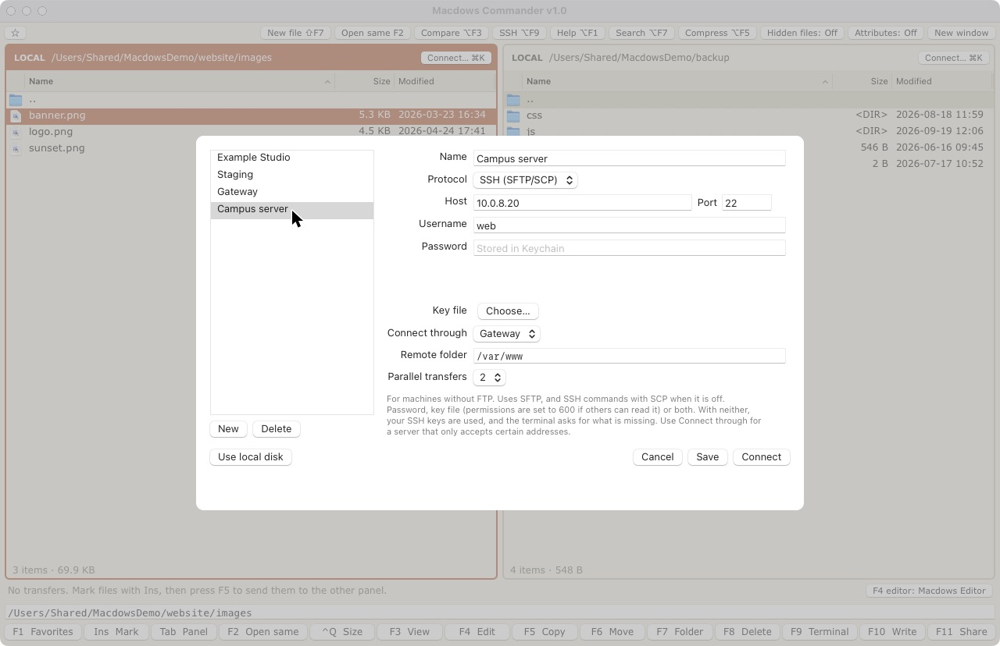

### Code editor (F4)

Colors for HTML, CSS, JavaScript and PHP, with syntax errors shown on their line. Find and replace, go to line, duplicate and delete lines, Save As. Encodings and line endings are kept as they were.

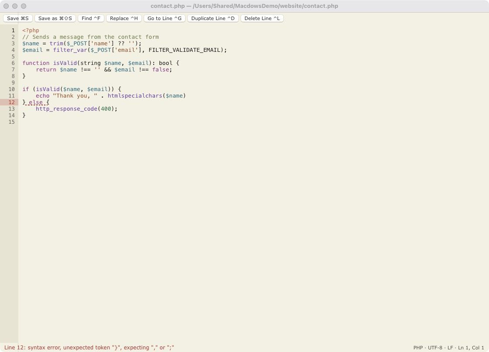

### Writing editor (F10)

Write directly on the page in HTML or Markdown, with the source one key away. The toolbar shows the format at the cursor, tables gain and lose rows and columns, and pasted text keeps only what the toolbar can make: other tags, attributes and scripts are removed.

| | |
|---|---|
| 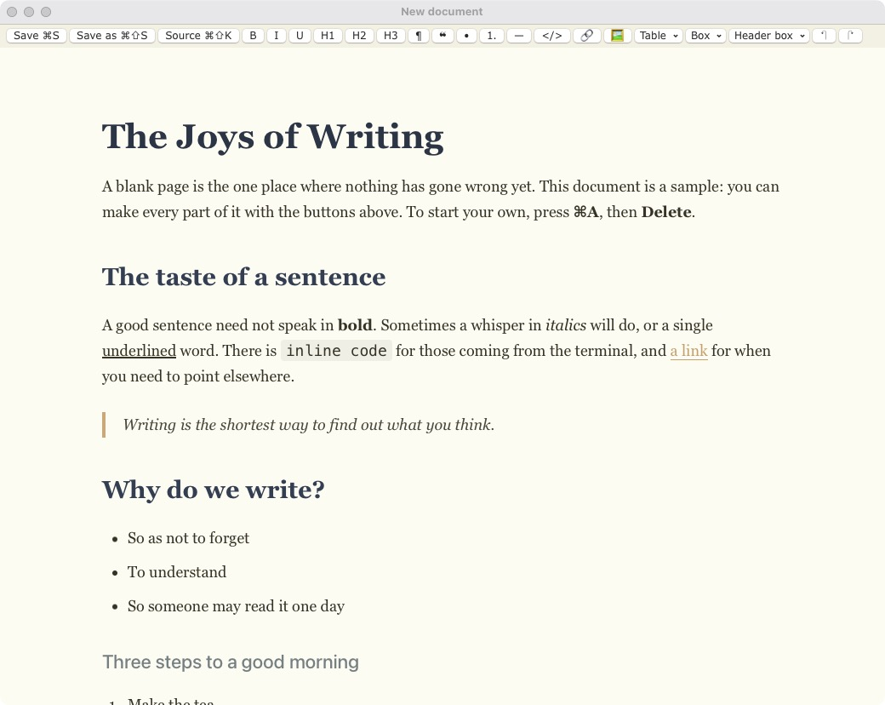 | 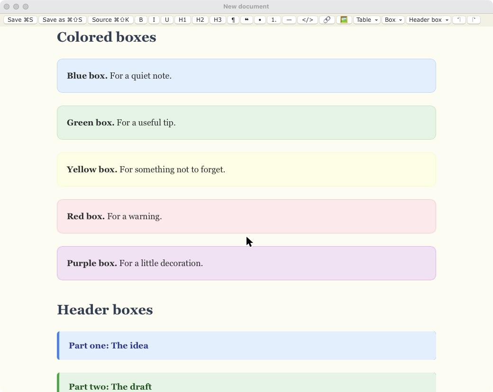 |

### Viewer and image tool (F3)

Pictures open at their real size. Crop, change the image or canvas size, rotate, flip, and add text with a color and a shadow. Save as PNG, JPG or WebP. PDF pages open too, and can be saved as images. HTML and Markdown files show as pages or as source; scripts in them don't run.

| | |
|---|---|
| 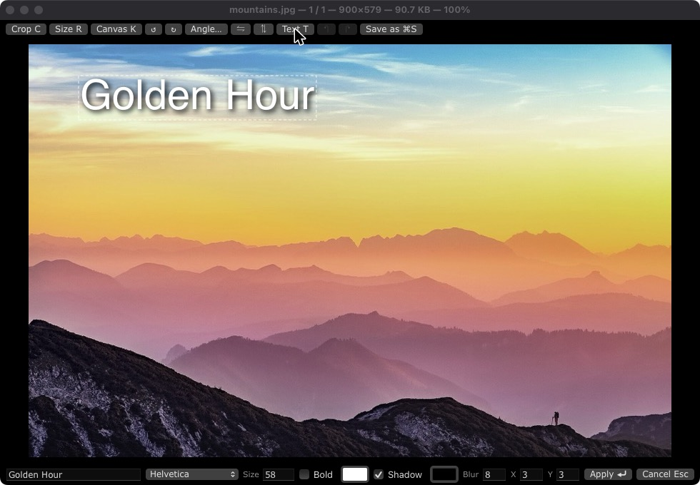 | 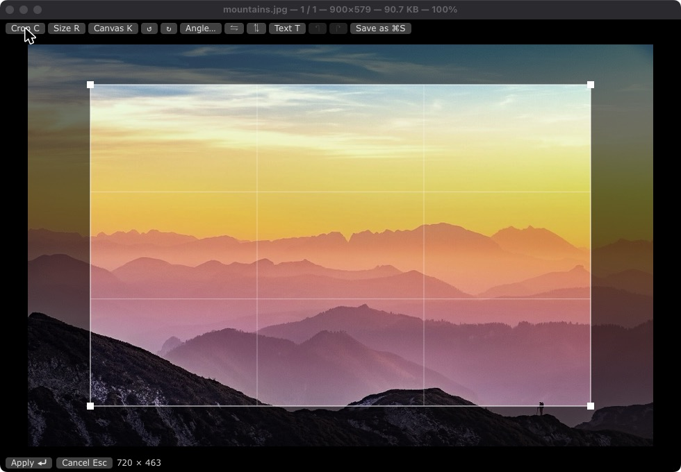 |

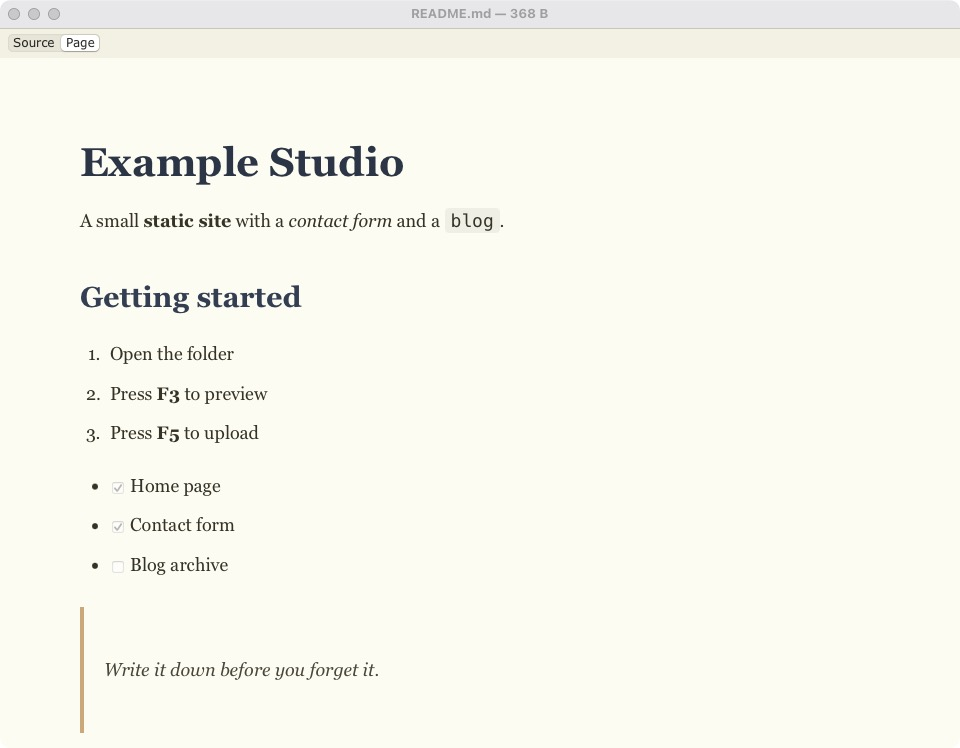

### Compare files

Two files side by side and lined up, with changed, added and removed lines in color. Each side shows its size and date, and says which file is newer.

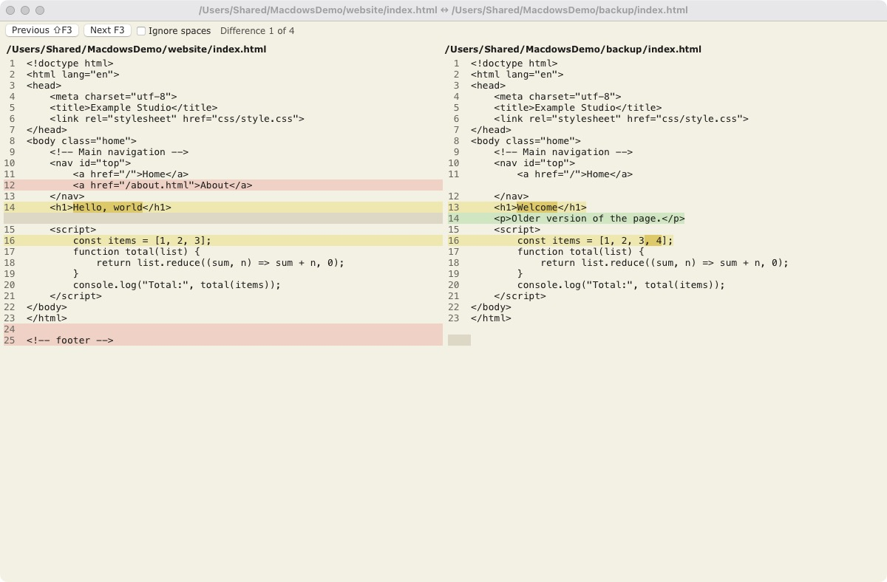

### Terminal

A terminal under the panels, with a row of Git buttons. Commands that only look run at once. Those that change something wait for you to press Enter.

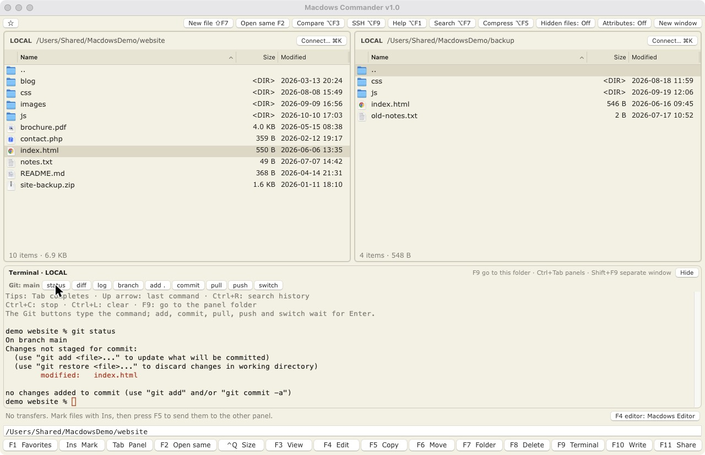

### Themes

Default dark, Light, Cream and Windows Commander, from the View menu, with a choice of fonts and sizes.

| | |
|---|---|
| 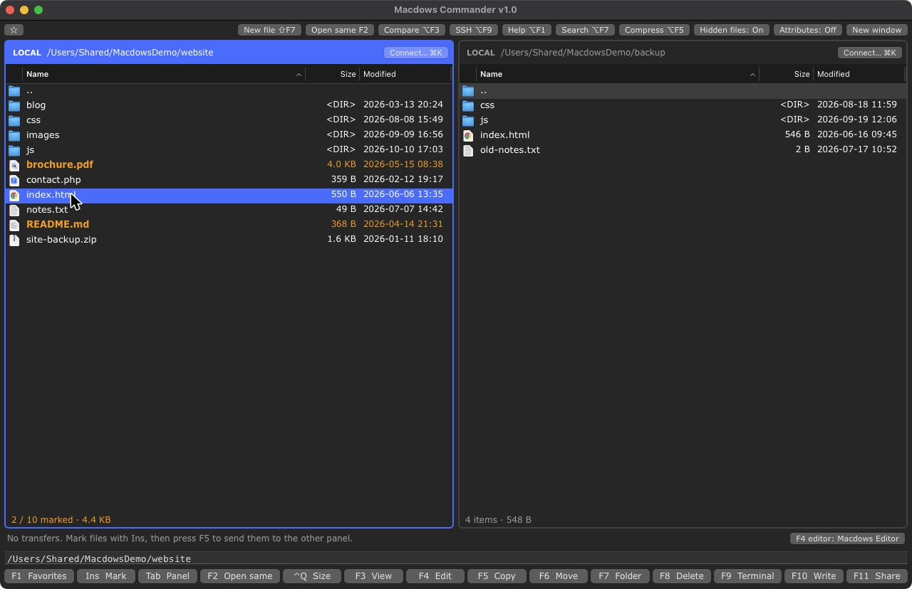 | 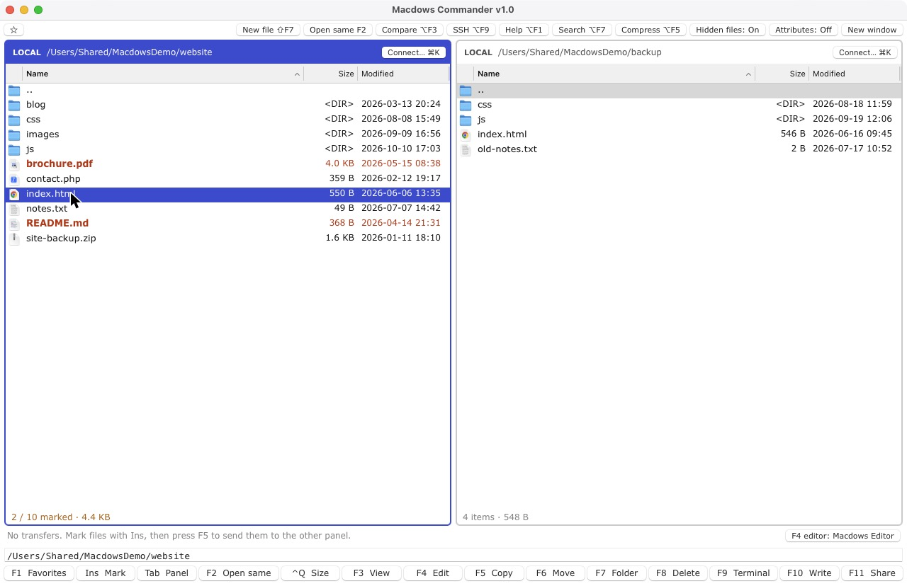 |
| 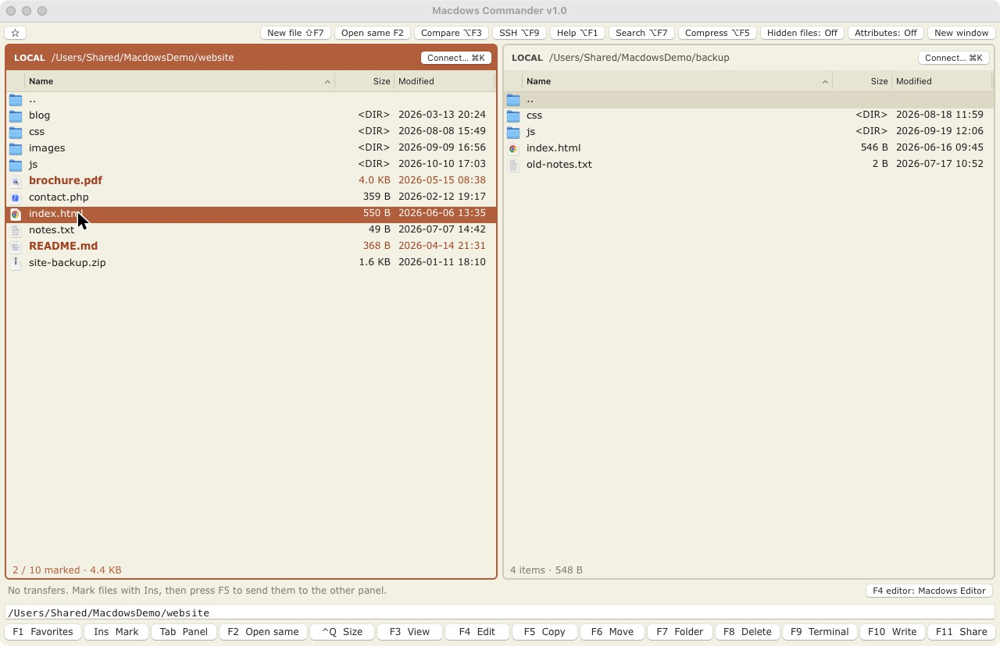 | 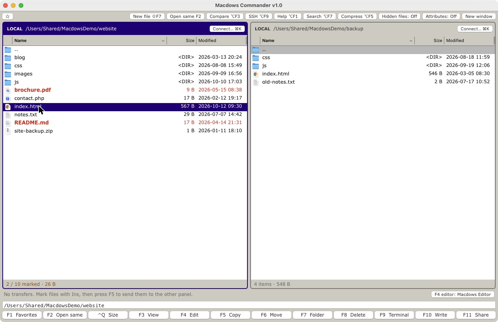 |

Press `⌥F1` in the app for every shortcut and the manual, in English or Turkish.

## Build

Needs macOS 13 or newer and the Swift toolchain.

```bash
scripts/build-app.sh
open "build/Macdows Commander.app"
```

If F keys change the brightness or volume on your Mac, press them with `Fn`, or turn on standard function keys in System Settings.

## Test

```bash
swift test
```

The tests against live servers are skipped unless `MC_TEST_DIR` is set. See `scripts/test-servers.sh`.

## Built with

[SwiftTerm](https://github.com/migueldeicaza/SwiftTerm) for the terminal and [libwebp](https://github.com/SDWebImage/libwebp-Xcode) for saving WebP.

The screenshots use a sample folder and made-up servers. The photo is [Pink mountain sunset](https://commons.wikimedia.org/wiki/File:Altm%C3%BCnster_-_Pink_mountain_sunset.jpg) by simon, under CC0.

## License

[MIT](LICENSE)
