# Macdows Commander

macOS için Windows Commander ruhunda, iki panelli yerel dosya yöneticisi. Swift ve AppKit ile yazıldı; klavyeyle çalışır, FTP, SSH, editörler ve resim aracı içindedir.

[English](README.md) · **Türkçe**

**[⬇ Mac için indir (DMG, 4.7 MB)](https://github.com/aynikola/macdows-commander/releases/latest/download/Macdows-Commander-1.2.1.dmg)** · macOS 13+, Apple Silicon ve Intel · [tüm sürümler](https://github.com/aynikola/macdows-commander/releases)

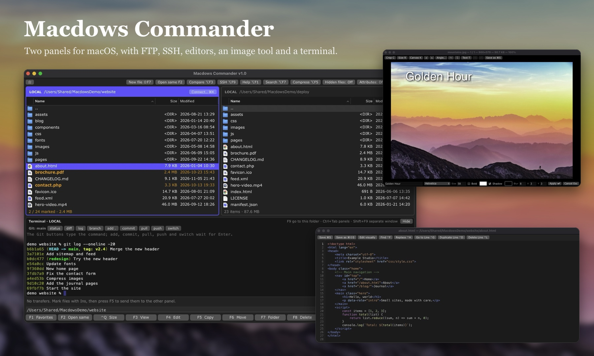

## Özellikler

### Klavyeyle çalışan iki panel

- `Ins` veya `Boşluk` işaretler, `Shift`+tık aralık işaretler, `Ctrl+A` hepsini işaretler
- `F5` kopyalar, `F6` taşır, `F7` klasör, `Shift+F7` metin, HTML veya Markdown dosyası açar, `F8` siler
- Var olan dosyanın üzerine sormadan yazılmaz; kopyayı yeniden adlandırabilirsiniz
- Ada yavaşça ikinci kez tıklayınca yerinde yeniden adlandırılır
- Başka bir program klasörü değiştirince paneller kendiliğinden yenilenir
- Finder'ın renkli etiketleri adın yanında nokta olarak görünür
- `F2` aynı klasörü diğer panelde açar, alttaki yol kutusuna yol yapıştırıp Enter ile gidilir
- `⌘1`, `⌘2`, `⌘3` ada, boyuta ve tarihe göre sıralar; `⌘4` en yeniyi üste alır, klasör ve dosya karışık
- `F3` metin, HTML, Markdown, resim, PDF, video ve ses önizler
- Finder'dan dosya sürükleyip bırakabilir, Finder'a sürükleyebilirsiniz
- Ad ve içerik araması, zip ve tar arşivlerine girme, favori klasörler
- `F11` Mac'in paylaşım menüsünü açar, `⌥F3` iki dosyayı karşılaştırır

### Sunucular

Kayıtlı bağlantılarla FTP, FTPS, SFTP ve SCP. SSH girişi şifreyle, `.pem` anahtarla veya yalnızca belirli adresleri kabul eden makineler için başka bir sunucu üzerinden yapılabilir. Şifreler Anahtar Zinciri'nde tutulur.

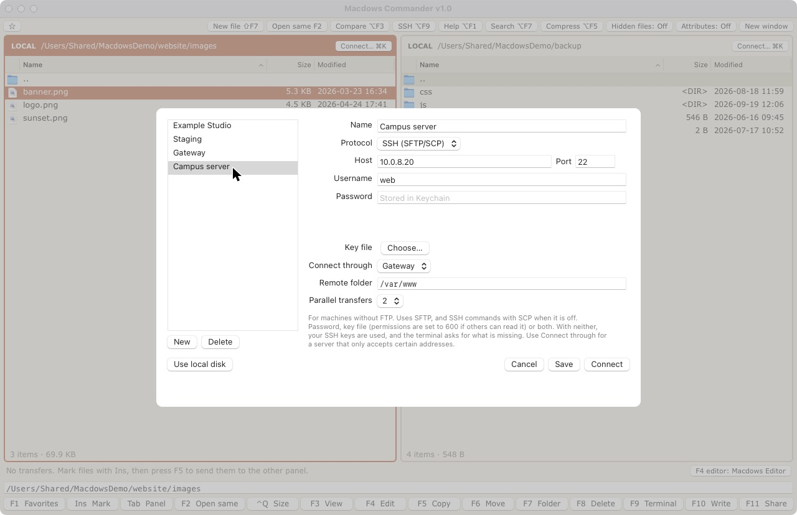

### Kod editörü (F4)

HTML, CSS, JavaScript ve PHP renklendirmesi; sözdizimi hataları kendi satırında gösterilir. Bul ve değiştir, satıra git, satır çoğalt ve sil, Farklı kaydet. Kodlama ve satır sonları olduğu gibi korunur.

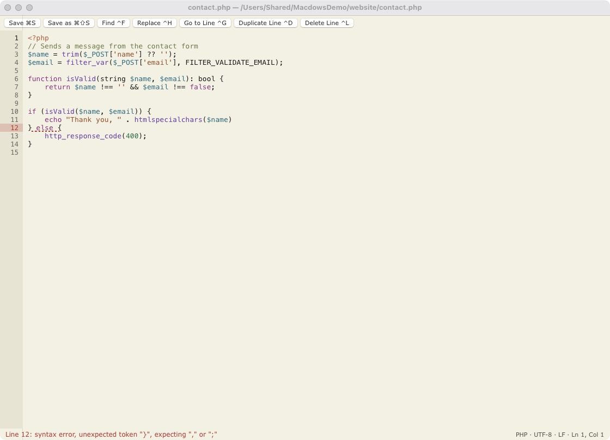

### Yazı editörü (F10)

HTML veya Markdown'u doğrudan sayfanın üstüne yazarsınız, kaynak bir tuş uzaktadır. Araç çubuğu imlecin bulunduğu biçimi gösterir, tablolara satır ve sütun eklenip silinir. Yapıştırılan metinde yalnızca düğmelerle yapılabilenler kalır; diğer etiket, öznitelik ve betikler silinir.

| | |
|---|---|
| 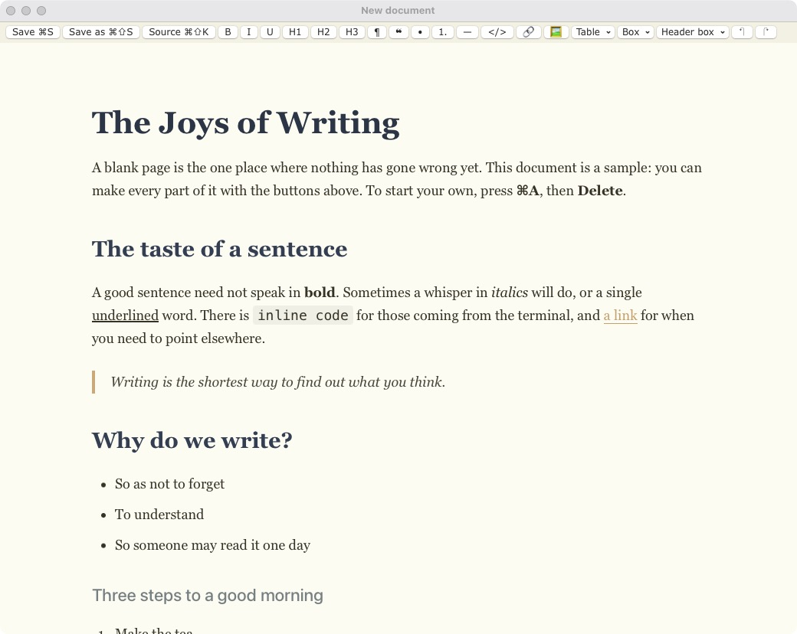 | 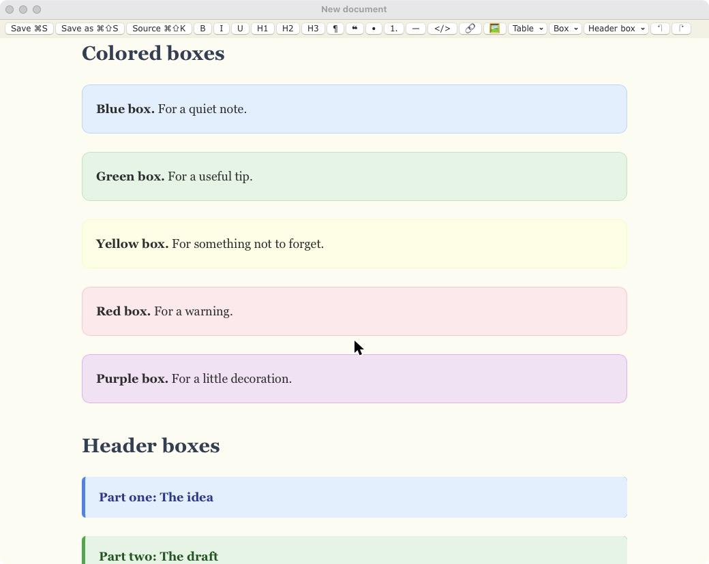 |

### Görüntüleyici ve resim aracı (F3)

Resimler gerçek boyutunda açılır. Kırpma, resim ve tuval boyutu, döndürme, çevirme, renkli ve gölgeli yazı. PNG, JPG veya WebP olarak kaydeder. PDF sayfaları da açılır ve resim olarak kaydedilir. HTML ve Markdown dosyaları sayfa veya kaynak olarak görünür; içlerindeki betikler çalışmaz.

| | |
|---|---|
| 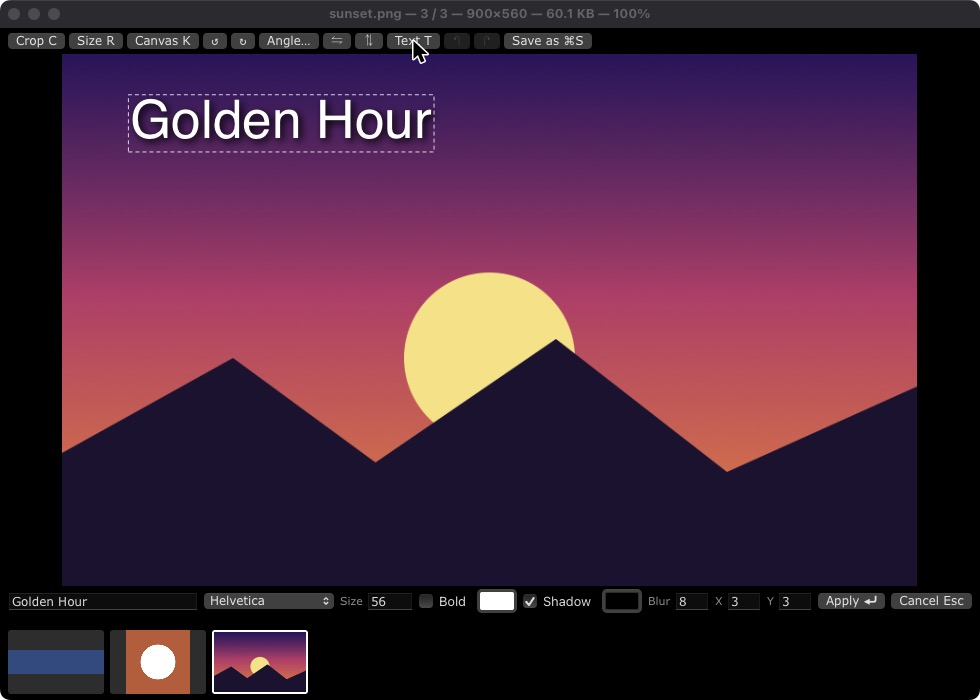 | 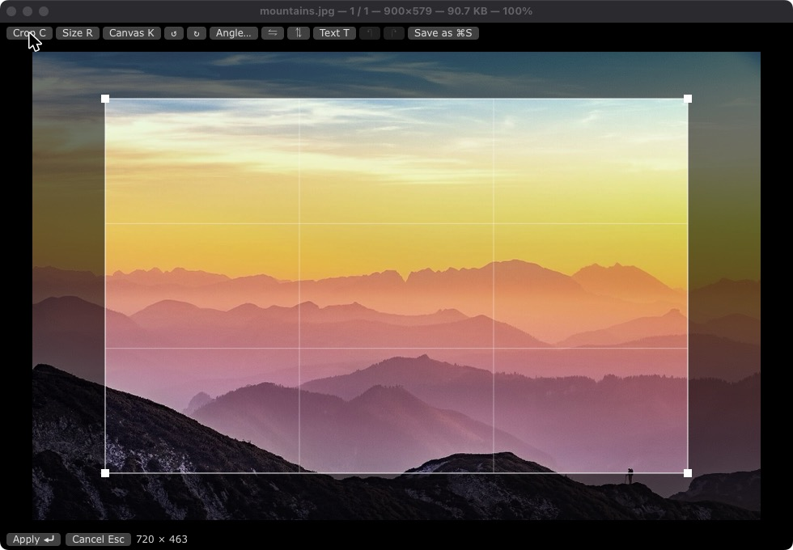 |

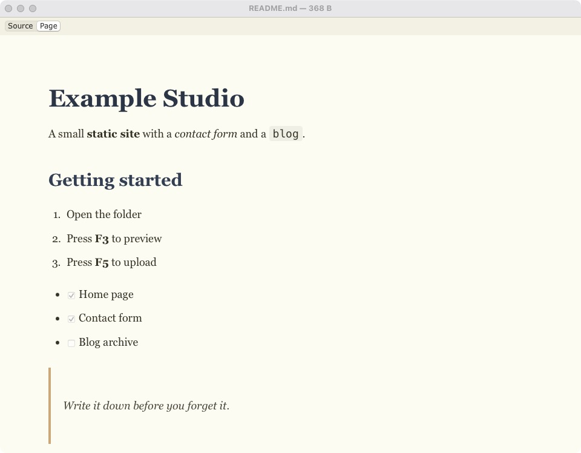

### Dosya karşılaştırma

İki dosya yan yana ve hizalı; değişen, eklenen ve silinen satırlar renkli. Her tarafta boyut ve tarih yazar, hangi dosyanın daha yeni olduğu görünür.

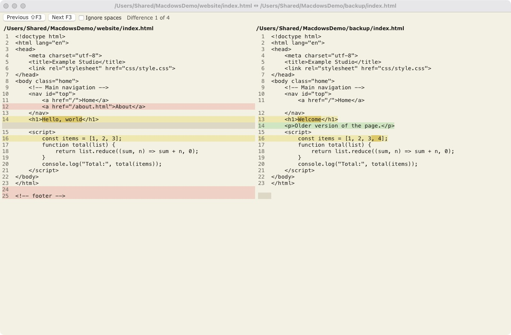

### Terminal

Panellerin altında terminal ve Git düğmeleri. Sadece bakan komutlar hemen çalışır, değişiklik yapanlar Enter'a basmanızı bekler.

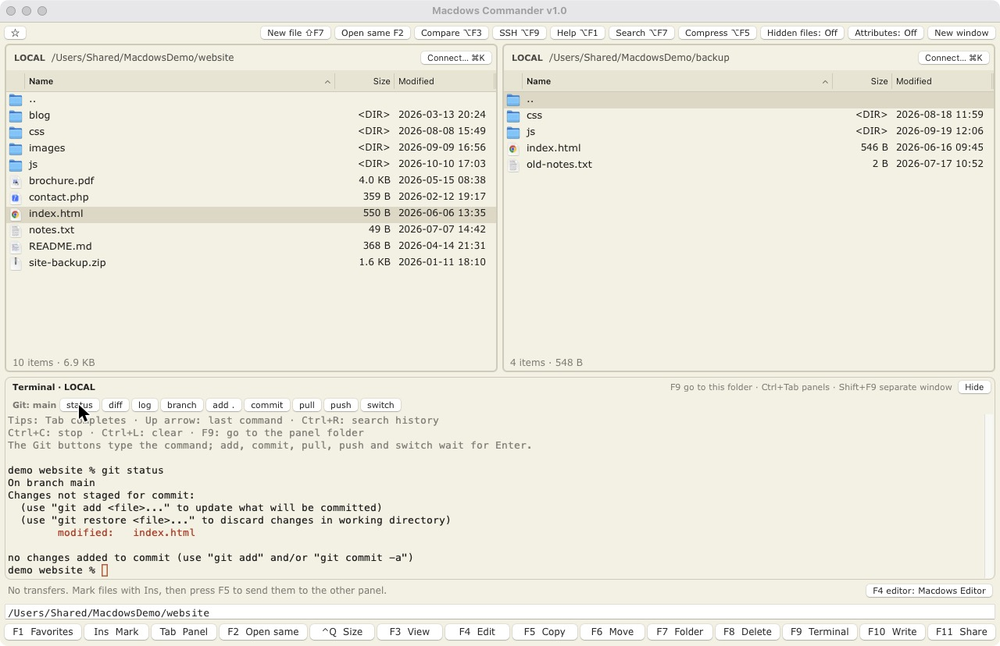

### Temalar

Görünüm menüsünden Varsayılan koyu, Açık, Krem ve Windows Commander; font ve boyut seçimi de orada.

| | |
|---|---|
| 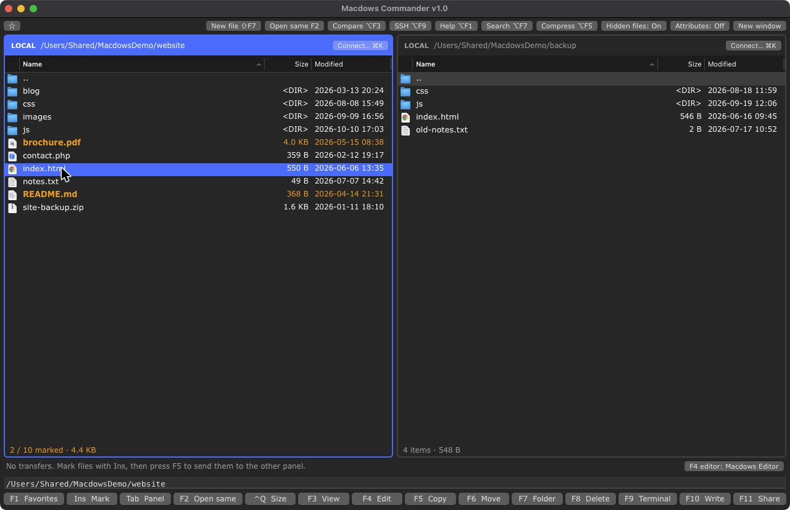 | 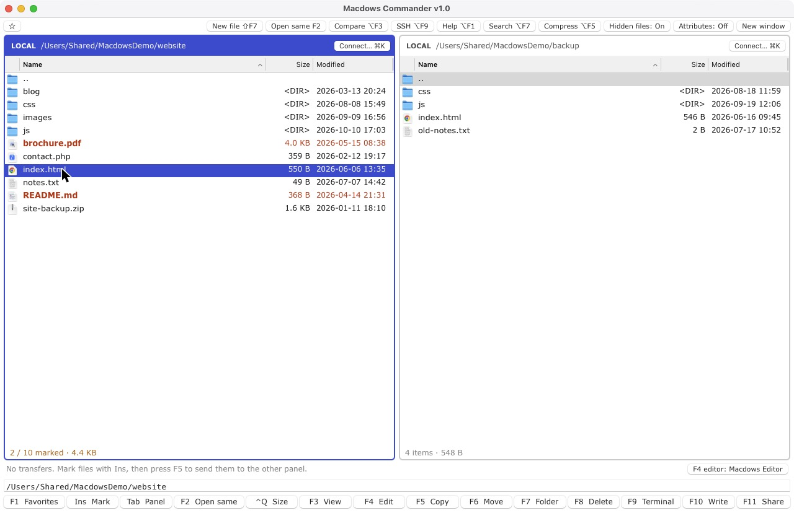 |
| 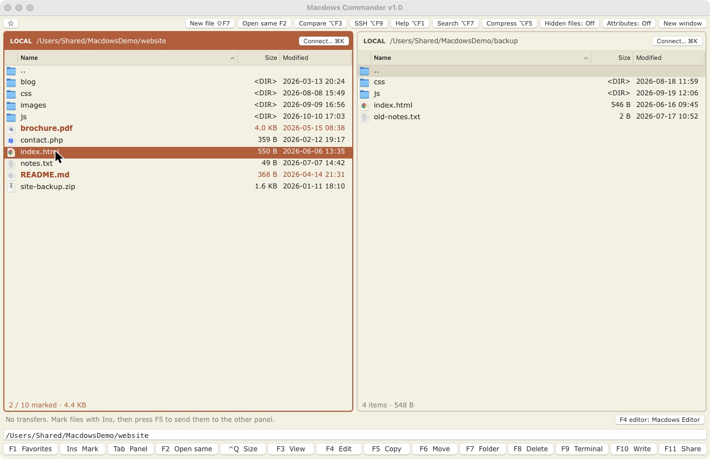 | 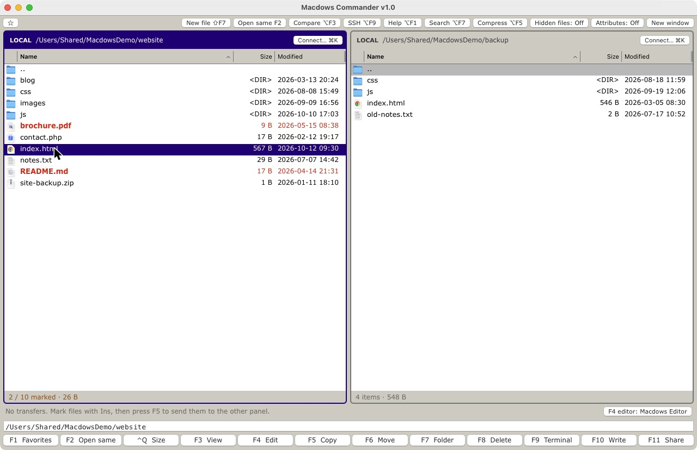 |

Tüm kısayollar ve kılavuz için uygulamada `⌥F1`'e basın; Türkçe ve İngilizce vardır.

## İndirme

[DMG'yi indirin](https://github.com/aynikola/macdows-commander/releases/latest/download/Macdows-Commander-1.2.1.dmg), açın ve **Macdows Commander**'ı yanındaki **Applications** (Uygulamalar) klasörünün üstüne sürükleyin. macOS 13 veya üstündeki Apple Silicon ve Intel Mac'lerde çalışır. Uygulamanın zip'i de [Releases](https://github.com/aynikola/macdows-commander/releases/latest) sayfasında.

Uygulama henüz bir Apple geliştirici hesabıyla imzalı değil, bu yüzden macOS ilk açılışta bir kez sorar:

- **macOS 14 ve öncesi:** Uygulamaya sağ tıklayıp **Aç** deyin, sonra yine **Aç**'a basın.
- **macOS 15:** Açmayı deneyin, uyarıyı kapatın, sonra **Sistem Ayarları → Gizlilik ve Güvenlik**'in en altındaki **Yine de Aç**'a basın.

## Derleme

macOS 13 veya üstü ve Swift araçları gerekir.

```bash
scripts/build-app.sh
open "build/Macdows Commander.app"
```

`scripts/package.sh` uygulamayı derleyip paylaşmak için `build/` içine bir DMG ve bir zip koyar. DMG'deki Applications okunu gösteren pencere için `pip install dmgbuild` gerekir; o yoksa DMG düz olur.

F tuşları Mac'inizde parlaklık veya sesi değiştiriyorsa `Fn` ile basın ya da Sistem Ayarları'ndan standart işlev tuşlarını açın.

## Test

```bash
swift test
```

`MC_TEST_DIR` tanımlı değilse gerçek sunucu testleri atlanır. Ayrıntı için `scripts/test-servers.sh`.

## Kullanılanlar

Terminal için [SwiftTerm](https://github.com/migueldeicaza/SwiftTerm), WebP kaydetmek için [libwebp](https://github.com/SDWebImage/libwebp-Xcode).

Ekran görüntülerinde örnek bir klasör ve uydurma sunucular kullanıldı. Fotoğraf: simon, [Pink mountain sunset](https://commons.wikimedia.org/wiki/File:Altm%C3%BCnster_-_Pink_mountain_sunset.jpg), CC0.

## Lisans

[MIT](LICENSE)
